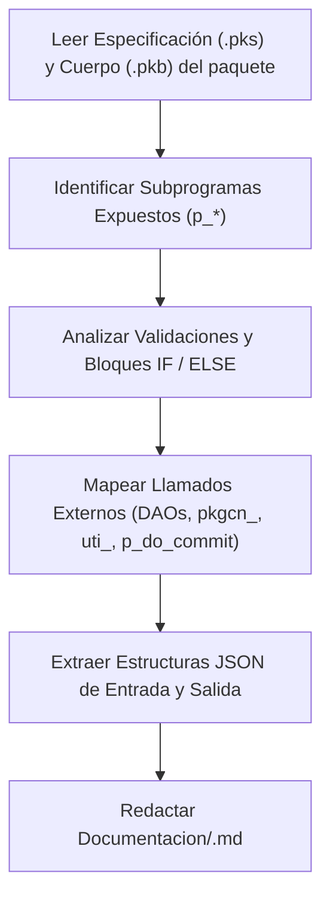

# Skill: Documentación Funcional de Flujo y Catálogo PL/SQL (<nombre_paquete>.md)

Este skill define las reglas institucionales, estándares de redacción, convenciones sintácticas y plantillas obligatorias para la creación y mantenimiento del **archivo de documentación funcional de flujo (`<nombre_paquete>.md`)** correspondiente a cada paquete orquestador de negocio (`pkgln_<dominio>`) en el ecosistema CORE.

---

## 1. Carácter Obligatorio y Propósito

> [!IMPORTANT]
> **Regla de Vinculación y Sincronización Innegociable:**
> Cada vez que se cree, refactorice, audite o ajuste cualquier procedimiento o función dentro de un paquete orquestador `pkgln_<dominio>` (`.pks` / `.pkb`), **es mandatorio crear o actualizar de inmediato su archivo de flujo: `Documentacion/<nombre_paquete>.md`** (ej: `pkgln_usuarios.md`, `pkgln_citas.md`, `pkgln_horarios.md`).

### Propósito del Archivo `.md`
1. **Fuente de Verdad del Visualizador Gráfico (`visor.html`):** Este archivo es consumido y analizado por el motor heurístico de `Documentacion/visor.html` para renderizar interactivamente diagramas de flujo tipo *Modern Glass*, graficar el árbol de decisiones con sus rombos (`decision-diamond`), pastillas de bifurcación (`SÍ / NO`), tarjetas de interrupción y el mapa de componentes invocados.
2. **Puente entre Negocio y Tecnología:** Describe en lenguaje natural claro y estructurado el comportamiento funcional del orquestador, haciéndolo comprensible para analistas funcionales, auditores, arquitectos y desarrolladores.
3. **Catálogo Institucional:** Provee la materia prima para alimentar la tabla de diccionario y catálogo `core_documentacion_metodo`.

---

## 2. Ubicación y Convención de Nomenclatura

* **Ruta estándar en el repositorio:** `Documentacion/<nombre_paquete>.md`
* **Nombre de archivo estricto:** El nombre del archivo debe coincidir **exactamente con el nombre del paquete PL/SQL en minúsculas** seguido de la extensión `.md`.
  * Paquete: `pkgln_usuarios` $\rightarrow$ Archivo: `Documentacion/pkgln_usuarios.md`
  * Paquete: `pkgln_citas` $\rightarrow$ Archivo: `Documentacion/pkgln_citas.md`
  * Paquete: `pkgln_horarios` $\rightarrow$ Archivo: `Documentacion/pkgln_horarios.md`
  * Paquete: `uti_manejo_trazas_pkg` $\rightarrow$ Archivo: `Documentacion/uti_manejo_trazas_pkg.md`

---

## 3. Estructura Obligatoria del Archivo `<nombre_paquete>.md`

Todo archivo de documentación debe estructurarse estrictamente bajo las siguientes secciones:

```markdown
# Diagrama y Flujo de Información: <NOMBRE_PAQUETE_EN_MAYUSCULAS>

## Método: <nombre_subprograma>
### 1. Descripción en Lenguaje Natural
<Párrafos de descripción funcional, propósito de negocio, actores y retorno esperado>

### 2. Decisiones y Bifurcaciones Lógicas
- **Decisión 1 [<Tipo / Título Corto>]**: <Condición evaluada>; <Acción de la Rama SÍ>
- **Decisión 2 [<Tipo / Título Corto>]**: <Condición evaluada>; <Acción de la Rama SÍ>
...

### 3. Mapa de Objetos Invocados y Llamados
| Orden | Nombre Exacto del Objeto Invocado | Capa / Familia | Tipo | Propósito de la Invocación | Condición / Momento |
| :---: | :--- | :--- | :--- | :--- | :--- |
| 1 | `paquete.subprograma` | `Capa` | Función/Procedimiento | Descripción técnica | Momento de ejecución |
...

```json
{
  "//": "PAYLOAD JSON DE ENTRADA (p_json_entrada)"
}
```

```json
{
  "//": "PAYLOAD JSON DE SALIDA (p_json_salida)"
}
```
```

---

## 4. Especificación Detallada de Cada Sección

### 4.1 Encabezado General (H1)
Debe abrir el documento identificando el paquete:
```markdown
# Diagrama y Flujo de Información: PKGLN_USUARIOS
```

### 4.2 Encabezado de Método (H2)
Cada procedimiento o función orquestadora expuesta en `pkgln_` se declara con:
```markdown
## Método: p_procesar_usuario
```
*(Si el paquete contiene más de un subprograma, se repiten secuencialmente las secciones 1 a 4 para cada uno).*

---

### 4.3 Sección 1: Descripción en Lenguaje Natural
Debe redactarse en un tono funcional y amigable para el negocio. Debe contener:
1. **Propósito Principal:** Qué proceso de negocio resuelve el método.
2. **Actor o Disparador:** Quién invoca el método (ej. Portal Web de Pacientes, API Gateway externo, Job administrativo nocturno, Aplicación Móvil).
3. **Condiciones Previas:** Requisitos necesarios para la invocación (ej. token de sesión M2M autenticado, payload con `id_tenant`).
4. **Resultado y Retorno:** Qué datos devuelve al completar con éxito (`codigo: 0`) y qué comportamiento asume si se interrumpe por validación.

---

### 4.4 Sección 2: Decisiones y Bifurcaciones Lógicas (Reglas del Visor)

> [!CRITICAL]
> **Sintaxis de Reconocimiento Automático por `visor.html`:**
> Cada paso o decisión debe redactarse como un ítem de lista obligatoriamente con la estructura:
> - Para decisiones: `- **Decisión N [Nombre / Etiqueta]** [Línea XXX]: <Condición evaluada>; <Acción si se cumple la condición (SÍ)>`
> - Para pasos secuenciales: `- **Paso N [Nombre / Etiqueta]** [Línea XXX]: <Acción ejecutada y objeto invocado>`
> 
> **Badge de Número de Línea (`[Línea XXX]` o `[L: XXX]`):**
> Permite indicar la línea exacta del código fuente PL/SQL en el paquete (`.pkb`). El visor extrae este dato automáticamente y lo proyecta como un badge distintivo (`L:XXX`) en el encabezado del rombo, la tarjeta del paso, el tooltip inteligente, el modal popover y el timeline lateral.
> 
> El carácter de punto y coma (**`;`**) es el delimitador oficial para decisiones:
> - **Antes del `;`:** El texto que se proyecta dentro del **rombo de decisión**.
> - **Después del `;`:** La acción o consecuencia de la **rama condicional SÍ** que sale por el vértice derecho.
> - **Camino NO (por defecto):** El visor asume automáticamente que si la condición NO se cumple, el flujo continúa verticalmente hacia el paso subsiguiente.

#### Tipología de Rombos y Palabras Clave Obligatorias:

1. **Rombo Rojo (Validación / Error / Salida Terminal - `isTerminalExit`):**
   * **Uso:** Validaciones de entrada, datos nulos, registros duplicados, reglas bloqueantes o accesos denegados que **interrumpen la ejecución** y finalizan retornando código de error negativo (ej. `-20001`, `-20002`).
   * **Palabras Clave en la Acción (después del `;`):** Debe incluir al menos una de las palabras: `Salida inmediata`, `interrumpe el flujo`, `rechaza`, `aborta`, `código -`, `retorna -`, `bloqueada`.
   * **Ejemplo:**
     ```markdown
     - **Decisión 1 [Validación de Entrada]**: Si el payload viene nulo o no contiene correo electrónico; Salida inmediata con código -20001 por datos obligatorios ausentes
     - **Decisión 4 [Validación de Duplicidad]**: Si `PKGCORE_USUARIO_DAO.f_existe` retorna 1; Se interrumpe el flujo y retorna código -20002 por usuario ya registrado
     ```

2. **Rombo Cian (Bifurcación que Vuelve al Flujo Principal - `returnsToMain`):**
   * **Uso:** Rutas condicionales opcionales donde, si se cumple la condición, se ejecuta una acción secundaria (ej. crear una entidad complementaria, poblar una tabla opcional) y **luego se reintegra al tronco principal**.
   * **Palabras Clave en la Acción (después del `;`):** Debe incluir: `Vuelve al flujo principal`, `retorna al flujo`, `reintegra`, `reincorpora`.
   * **Ejemplo:**
     ```markdown
     - **Decisión 3 [Existencia de Persona]**: Si `PKGCORE_PERSONA_DAO.f_existe` retorna 0; Se inserta nueva persona mediante `PKGCORE_PERSONA_DAO.p_insertar` y vuelve al flujo principal
     - **Decisión 5 [Asignación de Roles]**: Si el array roles viene poblado; Invoca inserciones con `pkgcn_usuarios.p_asignar_roles` y reintegra al flujo
     ```

3. **Rombo Ámbar (Punto de Decisión Estándar):**
   * **Uso:** Evaluaciones de negocio estándar sin interrupción terminal (ej. evaluación de parámetros o configuración).
   * **Ejemplo:**
     ```markdown
     - **Decisión 2 [Evaluación de Trazabilidad]**: Si `uti_manejo_trazas_pkg.f_debe_trazar` retorna TRUE; Registra inicio de traza en core_traza_ejecucion
     ```

---

### 4.5 Sección 3: Mapa de Objetos Invocados y Llamados
Debe contener obligatoriamente una tabla Markdown con las 6 columnas en el siguiente orden:

| Columna | Nombre | Descripción y Reglas de Contenido |
| :---: | :--- | :--- |
| 1 | **Orden** | Número secuencial (1, 2, 3...) según el orden de ejecución cronológico. |
| 2 | **Nombre Exacto del Objeto Invocado** | Nomenclatura oficial con comillas invertidas (ej. `` `uti_manejo_trazas_pkg.f_debe_trazar` ``, `` `PKGCORE_PERSONA_DAO.f_existe` ``, `` `pkgcn_citas.p_insertar_con_detalle` ``, `` `p_do_commit` ``). |
| 3 | **Capa / Familia** | Clasificación arquitectónica: `uti_`, `DAO`, `pkgcn_`, `pkgca_`, `Transaccional`. |
| 4 | **Tipo** | Tipo de subprograma: `Función` o `Procedimiento`. |
| 5 | **Propósito de la Invocación** | Resumen conciso de la tarea que realiza el objeto invocado. |
| 6 | **Condición / Momento** | Momento de invocación (ej. *Al inicio del proceso*, *Si no existe registro previo*, *Éxito sin excepciones*, *Bloque WHEN OTHERS*). |

#### Secuencia Canónica Obligatoria en la Tabla de Llamados de un Orquestador `pkgln_`:
1. `uti_manejo_trazas_pkg.f_debe_trazar` (`uti_` | Función | Al inicio).
2. `uti_manejo_trazas_pkg.p_iniciar_traza` (`uti_` | Procedimiento | Si f_debe_trazar = TRUE).
3. Consultas/Verificaciones con DAOs (`PKGCORE_<TABLA>_DAO.f_existe` / `f_traer`) o `pkgca_`.
4. Operaciones DML multi-tabla coordinadas con `pkgcn_<dominio>`.
5. Inserciones o actualizaciones unitarias con `PKGCORE_<TABLA>_DAO.p_insertar` / `p_actualizar`.
6. Confirmación atómica obligatoria con `p_do_commit` (`Transaccional` | Procedimiento | Éxito sin excepciones).
7. Cierre de telemetría exitosa con `uti_manejo_trazas_pkg.p_finalizar_traza` (`uti_` | Procedimiento | Antes de responder).
8. Manejo forense de excepciones en `WHEN OTHERS`:
   - `uti_manejo_trazas_pkg.p_finalizar_traza_error` (`uti_` | Procedimiento | En fallo no controlado).
   - `uti_ge_excepciones_pkg.p_grabar_log` (`uti_` | Procedimiento | Registro autónomo en `core_error`).

---

### 4.6 Sección 4: Esquemas y Payloads JSON de Ejemplo

Deben ubicarse dos bloques de código con lenguaje `json`:

1. **JSON de Entrada (`p_json_entrada`):**
   * Debe incluir obligatoriamente el atributo `"id_tenant": NUMBER`.
   * Atributos de trazabilidad (`"id_usuario_ejecutor"` o `"id_usuario"`, `"codigo_traza"` opcional).
   * Contenedor de datos o campos directos con valores de prueba realistas y comprensibles.

2. **JSON de Salida (`p_json_salida`):**
   * Debe contener `"codigo": 0`, `"mensaje": "..."` descriptivo y `"datos": { ... }` con los identificadores o entidades generadas.
   * Opcionalmente se puede incluir el ejemplo de retorno de error de negocio (`codigo: -20001`).

---

## 5. Procedimiento Paso a Paso para Extraer y Generar la Documentación desde el Código PL/SQL

Cuando se solicite documentar un paquete `pkgln_<dominio>`, se debe seguir estrictamente este flujo de 5 pasos:



### Paso 1: Identificación de Subprogramas y Propósito Funcional
- Abrir el archivo `.pks` y leer las firmas públicas `p_* (p_json_entrada IN CLOB, p_json_salida OUT CLOB)`.
- Leer los comentarios de cabecera y deducir el flujo comercial o de negocio que coordina el procedimiento.

### Paso 2: Análisis de Bifurcaciones y Reglas de Negocio
- Recorrer el cuerpo (`.pkb`) buscando sentencias `IF ... THEN ... ELSE / ELSIF ... END IF;`.
- Identificar cada validación:
  * Si la condición evalúa datos obligatorios ausentes o registros no existentes y ejecuta `ROLLBACK; RETURN;` con código negativo, se documenta como **Rombo Rojo (Salida terminal)**.
  * Si la condición evalúa si se debe ejecutar una rama complementaria y continúa, se documenta como **Rombo Cian (Retorno al flujo)**.
  * Si es evaluación de telemetría u opciones generales, se documenta como **Rombo Ámbar**.

### Paso 3: Identificación de Llamados y Componentes
- Buscar todas las invocaciones a:
  * Paquetes utilitarios: `uti_manejo_trazas_pkg.*`, `uti_ge_excepciones_pkg.*`, `uti_validaciones_pkg.*`.
  * Paquetes DAO: `PKGCORE_*_DAO.*`.
  * Paquetes de acceso mono-tabla: `pkgca_*.*`.
  * Paquetes multi-tabla: `pkgcn_*.*`.
  * Procedimiento de commit: `p_do_commit('*')`.
- Ordenar cronológicamente las llamadas en la tabla de llamados con sus parámetros de condición.

### Paso 4: Construcción de Ejemplos JSON
- Revisar las llamadas a `v_obj_in.get_string(...)`, `v_obj_in.get_number(...)` para deducir el schema de entrada.
- Revisar la sentencia `SELECT JSON_OBJECT(...) INTO p_json_salida FROM DUAL;` para deducir el schema de salida exitoso.

### Paso 5: Escritura y Verificación en `Documentacion/<nombre_paquete>.md`
- Redactar el archivo Markdown asegurando que las decisiones usen el delimitador punto y coma (`;`).
- Comprobar que no queden bloques vacíos ni tablas rotas.

---

## 6. Ejemplo Completo de Referencia

A continuación se presenta un ejemplo real, canónico y probado para el paquete `pkgln_usuarios`:

````markdown
# Diagrama y Flujo de Información: PKGLN_USUARIOS

## Método: p_procesar_usuario
### 1. Descripción en Lenguaje Natural
Gestiona la creación o actualización atómica de usuarios de la plataforma garantizando consistencia relacional y auditoría:
- Resuelve el enrolamiento de colaboradores validando previamente existencia de persona y roles asignados.
- Disparado por el API Gateway o Portal Administrativo mediante token institucional.
- Retorna código 0 con ID y código de traza si es exitoso, o código negativo estructurado en caso de fallo.

### 2. Decisiones y Bifurcaciones Lógicas
- **Decisión 1 [Validación de Entrada]**: Si el payload viene nulo o no contiene correo electrónico; Salida inmediata con código -20001 por datos obligatorios ausentes
- **Decisión 2 [Evaluación de Trazabilidad]**: Si `uti_manejo_trazas_pkg.f_debe_trazar` retorna TRUE; Registra inicio de traza en core_traza_ejecucion
- **Decisión 3 [Existencia de Persona]**: Si `PKGCORE_PERSONA_DAO.f_existe` retorna 0; Se inserta nueva persona mediante `PKGCORE_PERSONA_DAO.p_insertar` y vuelve al flujo principal
- **Decisión 4 [Validación de Usuario Duplicado]**: Si `PKGCORE_USUARIO_DAO.f_existe` retorna 1; Se interrumpe el flujo y retorna código -20002 por usuario ya registrado
- **Decisión 5 [Asignación de Roles]**: Si el array roles viene poblado; Se invocan inserciones multi-tabla con `pkgcn_usuarios.p_asignar_roles` y reintegra al flujo
- **Decisión 6 [Transacción Exitosa]**: Confirma cambios de manera controlada invocando `p_do_commit`; Notifica éxito y finaliza telemetría

### 3. Mapa de Objetos Invocados y Llamados
| Orden | Nombre Exacto del Objeto Invocado | Capa / Familia | Tipo | Propósito de la Invocación | Condición / Momento |
| :---: | :--- | :--- | :--- | :--- | :--- |
| 1 | `uti_manejo_trazas_pkg.f_debe_trazar` | `uti_` | Función | Determinar si el método tiene telemetría activa | Al inicio del proceso |
| 2 | `uti_manejo_trazas_pkg.p_iniciar_traza` | `uti_` | Procedimiento | Registrar cabecera en core_traza_ejecucion | Si f_debe_trazar = TRUE |
| 3 | `PKGCORE_PERSONA_DAO.f_existe` | `DAO` | Función | Comprobar si la persona ya está registrada | Previo a insertar persona |
| 4 | `PKGCORE_PERSONA_DAO.p_insertar` | `DAO` | Procedimiento | Insertar datos básicos de la persona | Si no existe persona previa |
| 5 | `PKGCORE_USUARIO_DAO.f_existe` | `DAO` | Función | Verificar duplicidad de nombre de usuario | Previo a insertar usuario |
| 6 | `PKGCORE_USUARIO_DAO.p_insertar` | `DAO` | Procedimiento | Persistir credenciales y usuario | Si usuario es nuevo |
| 7 | `pkgcn_usuarios.p_asignar_roles` | `pkgcn_` | Procedimiento | Desglosar array JSON_TABLE e insertar roles | Si incluye roles en el payload |
| 8 | `p_do_commit` | `Transaccional` | Procedimiento | Confirmar cambios de forma controlada | Éxito sin excepciones |
| 9 | `uti_manejo_trazas_pkg.p_finalizar_traza` | `uti_` | Procedimiento | Registrar cierre de telemetría exitosa | Éxito antes de responder |
| 10 | `uti_ge_excepciones_pkg.p_grabar_log` | `uti_` | Procedimiento | Registro forense autónomo en core_error | Bloque WHEN OTHERS |

```json
{
  "id_tenant": 1,
  "id_usuario_ejecutor": 105,
  "datos": {
    "nombre_usuario": "jdoe_core",
    "correo_electronico": "jdoe@empresa.com",
    "primer_nombre": "John",
    "primer_apellido": "Doe"
  }
}
```

```json
{
  "codigo": 0,
  "mensaje": "Usuario procesado exitosamente",
  "datos": {
    "id": 1289,
    "codigo_traza": "TRZ-20261024-9981"
  }
}
```
````

---

## 7. Registro en Base de Datos: `core_documentacion_metodo` (Opcional)

Si el usuario solicita persistir el catálogo o sincronizar la base de datos con el archivo Markdown, se debe generar un script DML con sentencia `MERGE INTO core_documentacion_metodo`:

```sql
MERGE INTO core_documentacion_metodo dest
USING (
    SELECT 
        1 AS id_tenant,
        'PKGLN_USUARIOS' AS nombre_paquete,
        'p_procesar_usuario' AS nombre_metodo,
        'Procesamiento y Enrolamiento de Usuarios' AS titulo_funcional,
        'Gestiona la creación o actualización atómica de usuarios...' AS resumen_ejecutivo,
        'Administrador del Tenant / API Gateway' AS actor_principal,
        '1.0.0' AS version_metodo,
        'OPERATIVO' AS categoria_funcional,
        '1' AS es_activo
    FROM DUAL
) src
ON (dest.nombre_paquete = src.nombre_paquete AND dest.nombre_metodo = src.nombre_metodo)
WHEN MATCHED THEN
    UPDATE SET 
        dest.titulo_funcional    = src.titulo_funcional,
        dest.resumen_ejecutivo   = src.resumen_ejecutivo,
        dest.actor_principal     = src.actor_principal,
        dest.version_metodo      = src.version_metodo,
        dest.categoria_funcional = src.categoria_funcional
WHEN NOT MATCHED THEN
    INSERT (
        id_tenant, nombre_paquete, nombre_metodo, titulo_funcional, 
        resumen_ejecutivo, actor_principal, version_metodo, 
        categoria_funcional, es_activo
    )
    VALUES (
        src.id_tenant, src.nombre_paquete, src.nombre_metodo, src.titulo_funcional,
        src.resumen_ejecutivo, src.actor_principal, src.version_metodo,
        src.categoria_funcional, src.es_activo
    );
```
